# IPTV.MENU — Architecture & Technical Design

## 1. System Overview

**IPTV.MENU** is a hybrid multi-platform IPTV management, streaming, and automated Android application builder platform. It provides:
1. **Web & Smart TV Client**: A browser-based streaming application (React 19 + Vite) equipped with spatial D-Pad navigation for Smart TVs (Android TV, Fire TV, Chromecast, Nvidia Shield) and desktop/mobile browsers.
2. **REST API Gateway**: A Node.js Express server (`apps/api`) providing stream proxying, M3U manifest manipulation, EPG/XMLTV ingestion, multi-tenant workspace quotas, and Stripe billing.
3. **Background Worker Engine**: A standalone containerized worker (`apps/worker`) handling asynchronous M3U stream probing/cleaning, EPG feed aggregation, and Expo Application Services (EAS) mobile APK compilation.
4. **Mobile & Android TV App**: A React Native / Expo application (`mobile`) targeting Android devices, Google TV, and Fire TV with native `expo-video` playback.

---

## 2. Technology Stack & Component Breakdown

| Layer | Technologies & Frameworks | Primary Location | Entry Point |
|---|---|---|---|
| **Web Frontend** | React 19, TypeScript, Vite 6, Tailwind CSS v4, Lucide Icons, Framer Motion | [`/src`](file:///Volumes/MacAI/ABGlobalCEO/iptv-menu-app/src) | [`src/main.tsx`](file:///Volumes/MacAI/ABGlobalCEO/iptv-menu-app/src/main.tsx), [`src/App.tsx`](file:///Volumes/MacAI/ABGlobalCEO/iptv-menu-app/src/App.tsx) |
| **Mobile / TV App** | React Native 0.74, Expo SDK 51, Expo Router v3, Expo Video, FlashList, MMKV | [`/mobile`](file:///Volumes/MacAI/ABGlobalCEO/iptv-menu-app/mobile) | [`mobile/app/_layout.tsx`](file:///Volumes/MacAI/ABGlobalCEO/iptv-menu-app/mobile/app/_layout.tsx), [`mobile/app/index.tsx`](file:///Volumes/MacAI/ABGlobalCEO/iptv-menu-app/mobile/app/index.tsx) |
| **REST API Server** | Node.js 20, Express 4.21, Body-Parser, CORS, Drizzle ORM | [`/apps/api`](file:///Volumes/MacAI/ABGlobalCEO/iptv-menu-app/apps/api) | [`apps/api/src/server.ts`](file:///Volumes/MacAI/ABGlobalCEO/iptv-menu-app/apps/api/src/server.ts), [`api/index.ts`](file:///Volumes/MacAI/ABGlobalCEO/iptv-menu-app/api/index.ts) |
| **Background Worker** | Node.js 20, Axios, Docker Container | [`/apps/worker`](file:///Volumes/MacAI/ABGlobalCEO/iptv-menu-app/apps/worker) | [`apps/worker/src/index.ts`](file:///Volumes/MacAI/ABGlobalCEO/iptv-menu-app/apps/worker/src/index.ts) |
| **Shared Monorepo Packages** | TypeScript packages (auth, db, storage, billing, jobs, logging, config, types, ui) | [`/packages`](file:///Volumes/MacAI/ABGlobalCEO/iptv-menu-app/packages) | [`packages/*/src/index.ts`](file:///Volumes/MacAI/ABGlobalCEO/iptv-menu-app/packages) |
| **Database** | Neon Serverless PostgreSQL (`@neondatabase/serverless`) via Drizzle ORM, with legacy Firestore fallback | Cloud Neon / GCP | [`packages/db/src/client.ts`](file:///Volumes/MacAI/ABGlobalCEO/iptv-menu-app/packages/db/src/client.ts) |
| **Object Storage** | Vercel Blob (`@vercel/blob`) & Google Cloud Storage (`@google-cloud/storage`) | Vercel / GCS | [`packages/storage/src/index.ts`](file:///Volumes/MacAI/ABGlobalCEO/iptv-menu-app/packages/storage/src/index.ts) |
| **Billing & Payments** | Stripe API (Node SDK) & Webhooks | Stripe | [`packages/billing/src/index.ts`](file:///Volumes/MacAI/ABGlobalCEO/iptv-menu-app/packages/billing/src/index.ts) |
| **Mobile Cloud Builder** | Expo Application Services (EAS Build REST API) | Expo Cloud | [`packages/jobs/src/easBuildClient.ts`](file:///Volumes/MacAI/ABGlobalCEO/iptv-menu-app/packages/jobs/src/easBuildClient.ts) |

---

## 3. Component & Data Flow Diagram

```mermaid
flowchart TD
    subgraph Clients["Client Applications"]
        Browser["Desktop & Mobile Web Browser\n(React 19 + Hls.js Shim)"]
        SmartTV["Smart TV (D-Pad Navigation)\n(Fire TV / Android TV Web)"]
        MobileApp["Native Android / TV App\n(Expo SDK 51 + expo-video)"]
    end

    subgraph Edge["Vercel Edge & Ingress"]
        VercelCDN["Vercel CDN / Static Hosting\n(dist/ SPA)"]
        ServerlessAPI["Serverless API Engine\n(api/index.ts -> api/server.cjs)"]
    end

    subgraph Backend["REST API Core (Express)"]
        AuthRouter["Auth & Users Router\n(/api/public/auth)"]
        StreamProxy["CORS Stream Relay & M3U8 Rewriter\n(/api/stream/proxy)"]
        ChannelRouter["Channels & Metadata\n(/api/channels, /api/epg)"]
        WorkspaceRouter["Workspaces & Quotas\n(/api/workspaces, /api/playlists)"]
        BuildRouter["App Builder & APK Dispatch\n(/api/builds, /api/v1/apps)"]
        StripeWebhook["Stripe Billing & Webhooks\n(/api/webhooks/stripe)"]
    end

    subgraph DataStorage["Data & Artifact Persistence"]
        NeonDB[("Neon Serverless Postgres\n(Drizzle ORM)")]
        VercelBlob[("Vercel Blob / GCS\n(M3U Files, APK Artifacts)")]
        LocalCache[("Client LocalStorage / MMKV\n(Favorites, History, Custom Subs)")]
    end

    subgraph AsyncWorker["Background Worker (Container)"]
        WorkerLoop["Worker Task Loop\n(apps/worker/src/index.ts)"]
        Prober["Stream Health Prober\n(HTTP HEAD/Range Ping)"]
        EASBuilder["EAS Build Trigger\n(Expo EAS Cloud)"]
        EpgAggregator["EPG XMLTV Fetcher & Merger"]
    end

    subgraph External["External Services & Streams"]
        IPTVStreams["Upstream IPTV Video Streams\n(HLS .m3u8 / TS / Xtream Codes)"]
        IPTVOrg["iptv-org Community EPG & Feeds"]
        StripeAPI["Stripe Payments API"]
        ExpoCloud["Expo EAS Cloud Build Servers"]
    end

    Browser --> VercelCDN
    SmartTV --> VercelCDN
    MobileApp --> ServerlessAPI
    Browser --> ServerlessAPI
    SmartTV --> ServerlessAPI

    ServerlessAPI --> AuthRouter
    ServerlessAPI --> StreamProxy
    ServerlessAPI --> ChannelRouter
    ServerlessAPI --> WorkspaceRouter
    ServerlessAPI --> BuildRouter
    ServerlessAPI --> StripeWebhook

    StreamProxy -- "Relay & Rewrite Manifest" --> IPTVStreams
    ChannelRouter --> NeonDB
    WorkspaceRouter --> NeonDB
    AuthRouter --> NeonDB
    StripeWebhook --> NeonDB
    StripeWebhook --> StripeAPI

    BuildRouter -- "Queue Job" --> NeonDB
    WorkspaceRouter -- "Save Uploads" --> VercelBlob

    WorkerLoop -- "Poll Queued Jobs" --> NeonDB
    WorkerLoop --> Prober
    WorkerLoop --> EASBuilder
    WorkerLoop --> EpgAggregator

    Prober --> IPTVStreams
    EASBuilder --> ExpoCloud
    EpgAggregator --> IPTVOrg
    EpgAggregator --> VercelBlob

    Browser -.-> LocalCache
    SmartTV -.-> LocalCache
    MobileApp -.-> LocalCache
```

---

## 4. Key Subsystem Architectures

### 4.1 State Management Architecture
The frontend employs **Zustand** stores decoupled from UI components:
1. [`usePlayerStore.ts`](file:///Volumes/MacAI/ABGlobalCEO/iptv-menu-app/src/store/usePlayerStore.ts):
   - Active playback channel (`currentChannel`), candidate fallbacks, and retry status.
   - Channel collection (`channels`), active country filter, category/group filter, and search queries.
   - User favorites (`favorites`), playback history (`history`), bookmarks, and channel tagging.
   - Parental controls (PIN lock, locked channels, age restriction metadata).
   - Audio DSP settings (multi-band equalizer, bass boost, vocal clarity, spatial audio).
   - Sleep timer state machine (`sleepTimer`).
   - Local DVR stream recorder state (`activeRecording`).
   - Spatial TV navigation state (`tvNavigation`).
2. [`authStore.ts`](file:///Volumes/MacAI/ABGlobalCEO/iptv-menu-app/src/authStore.ts):
   - Auth session state (`isLoggedIn`, `email`, `role`, `token`, `isPremium`), synchronized to `localStorage` under key `iptv_auth_state`.
3. [`useWorkspaceStore.ts`](file:///Volumes/MacAI/ABGlobalCEO/iptv-menu-app/src/store/useWorkspaceStore.ts):
   - Active multi-tenant workspace, entitlements, and resource quotas.
4. [`useAdSenseStore.ts`](file:///Volumes/MacAI/ABGlobalCEO/iptv-menu-app/src/store/useAdSenseStore.ts):
   - Dynamic publisher client ID, slot configurations, and auto-ads toggle.

### 4.2 Networking & API Layer
- **Client Client-Side API Utility** ([`src/lib/apiClient.ts`](file:///Volumes/MacAI/ABGlobalCEO/iptv-menu-app/src/lib/apiClient.ts)):
  - Wraps native `fetch` with automatic bearer token injection from `authStore`.
  - Normalizes base URL dynamically via `VITE_API_URL`.
- **CORS Stream Proxy Gateway** ([`apps/api/src/services/streamProxyService.ts`](file:///Volumes/MacAI/ABGlobalCEO/iptv-menu-app/apps/api/src/services/streamProxyService.ts)):
  - Resolves browser mixed-content blocks (HTTPS web app attempting to load HTTP IPTV streams) and CORS origin blocks.
  - Rewrites M3U8 master playlists and media segment playlists dynamically so subsequent `.ts` chunks route back through the proxy relay.
  - Injects VLC spoofed `User-Agent` strings for upstream provider compatibility.

### 4.3 Authentication & Authorization Flow
Currently exists in a fractured state:
- **Express Backend** ([`apps/api/src/server.ts`](file:///Volumes/MacAI/ABGlobalCEO/iptv-menu-app/apps/api/src/server.ts)): Exposes `/api/public/auth/register` and `/api/public/auth/login`. Uses unsigned Base64-encoded JSON strings as bearer tokens.
- **Middleware Guard** ([`packages/auth/src/index.ts`](file:///Volumes/MacAI/ABGlobalCEO/iptv-menu-app/packages/auth/src/index.ts)): Checks for Firebase Admin configuration. If unconfigured or failing, falls back to parsing raw Base64 JSON tokens (`parseTokenPayload`) without cryptographic signature verification.
- **Frontend Dual-Integration**: Contains both [`src/lib/firebase.ts`](file:///Volumes/MacAI/ABGlobalCEO/iptv-menu-app/src/lib/firebase.ts) (partially stubbed) and [`src/lib/supabase.ts`](file:///Volumes/MacAI/ABGlobalCEO/iptv-menu-app/src/lib/supabase.ts) / [`src/hooks/useSupabaseAuth.ts`](file:///Volumes/MacAI/ABGlobalCEO/iptv-menu-app/src/hooks/useSupabaseAuth.ts).

### 4.4 Playlist (M3U) & EPG Handling
- **Client M3U Parser** ([`src/utils/m3uParser.ts`](file:///Volumes/MacAI/ABGlobalCEO/iptv-menu-app/src/utils/m3uParser.ts)):
  - Regex-driven single-pass parser extracting `#EXTINF` directives (`tvg-id`, `tvg-name`, `tvg-logo`, `group-title`, `tvg-country`, `tvg-language`).
  - Generates stable channel IDs using DJB2 hash of name + URL.
- **Backend EPG Engine** ([`apps/api/src/services/epgService.ts`](file:///Volumes/MacAI/ABGlobalCEO/iptv-menu-app/apps/api/src/services/epgService.ts)):
  - Parses XMLTV documents via regular expressions.
  - Maintains in-memory schedule maps for instant "Now & Next" lookups (`/api/epg/live`).
- **Xtream Codes Connector** ([`src/utils/xtreamClient.ts`](file:///Volumes/MacAI/ABGlobalCEO/iptv-menu-app/src/utils/xtreamClient.ts), [`apps/api/src/server.ts`](file:///Volumes/MacAI/ABGlobalCEO/iptv-menu-app/apps/api/src/server.ts)):
  - Proxies player API requests (`player_api.php`) for live streams, VOD, series categories, and short EPG listings.

### 4.5 Video Player Integration
- **Web App**:
  - Leverages [`src/shims/expo-video.tsx`](file:///Volumes/MacAI/ABGlobalCEO/iptv-menu-app/src/shims/expo-video.tsx), which intercepts `useVideoPlayer` and `VideoView` imports and mounts an HTML5 `<video>` element.
  - Dynamically injects `hls.js` from CDN when an `.m3u8` or `/api/stream/proxy` stream is detected.
  - Includes full Web Audio API DSP pipeline ([`src/utils/audioDspEngine.ts`](file:///Volumes/MacAI/ABGlobalCEO/iptv-menu-app/src/utils/audioDspEngine.ts)) for 5-band graphic EQ, compressor, and stereo widening.
- **Mobile / Android TV**:
  - Leverages native Expo SDK 51 `expo-video` module with hardware-accelerated ExoPlayer (Android) and AVPlayer (iOS).
  - Configured with `supportsBackgroundPlayback: true` and `supportsPictureInPicture: true`.

### 4.6 Local Storage & TV Remote Navigation
- **Local Storage**:
  - Web: Shimmed [`src/shims/react-native-mmkv.ts`](file:///Volumes/MacAI/ABGlobalCEO/iptv-menu-app/src/shims/react-native-mmkv.ts) storing JSON strings under `@MMKV:default_mmkv:` in `window.localStorage`.
  - Mobile: Native C++ binary `react-native-mmkv` with direct memory-mapped file persistence.
- **TV Remote Navigation** ([`src/utils/spatialNavigation.ts`](file:///Volumes/MacAI/ABGlobalCEO/iptv-menu-app/src/utils/spatialNavigation.ts), [`src/hooks/useSpatialNavigation.ts`](file:///Volumes/MacAI/ABGlobalCEO/iptv-menu-app/src/hooks/useSpatialNavigation.ts)):
  - 2D coordinate-based directional distance algorithm (`ArrowUp`, `ArrowDown`, `ArrowLeft`, `ArrowRight`, `Enter`, `Back`).
  - Scans DOM elements annotated with `data-tv-focus` and assigns visual focus halos with smooth scroll into viewport.
