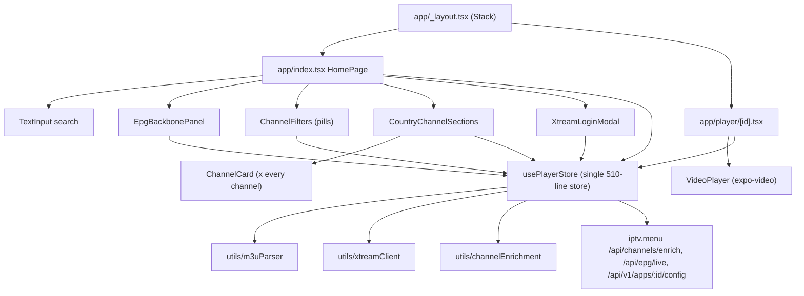
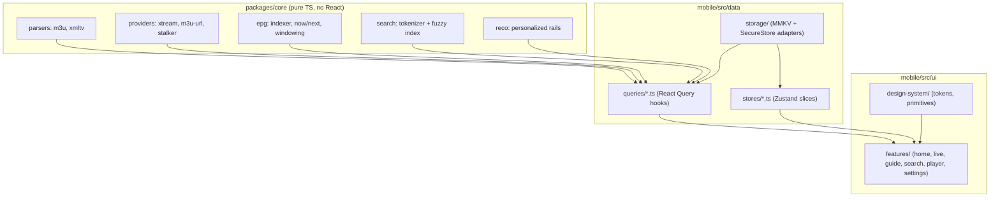

# IPTV Next-Gen UI Overhaul — Phase 1 Audit & Phase 2 Architecture

> **Status:** for review. No code has been changed. Phase 3 starts only after you approve this plan and answer the **Decisions** at the bottom.

---

# Phase 1 — Codebase Audit & Component Map

## 1.1 Two separate frontends

| Surface | Path | Stack | Ships to |
|---|---|---|---|
| **Native app** | `mobile/` | Expo SDK 51, RN 0.74.5, expo-router 3, expo-video 1.1, Zustand 4, MMKV | Android / Fire TV (APK/AAB), iOS (configured, no tvOS) |
| **Web/desktop app** | `src/` | Vite 6, React 19, Tailwind 4, motion, hls.js/mpegts.js, Zustand 5, Electron | Browser, Electron |

The web app runs RN-style code through hand-written shims (`src/shims/react-native.tsx`, `src/shims/expo-video.tsx`, …). `Platform.OS` is hard-coded to `'ios'` there.

**The App Store / Amazon Appstore target is `mobile/`.** That's where this overhaul focuses.

## 1.2 Native app component map (`mobile/`)



- **State:** one Zustand store (`mobile/src/store/usePlayerStore.ts`) mixes library data, EPG, Xtream accounts, OTA config, favorites/history, and storage I/O.
- **Data fetching:** raw `fetch` + `AbortController` inside store actions. No caching layer, no request dedupe.

## 1.3 Critical bugs (fix regardless of redesign)

| # | Issue | Location |
|---|---|---|
| B1 | **Tapping a channel toggles favorite instead of playing it.** The player route is unreachable from the UI. | `mobile/src/components/CountryChannelSections.tsx:45` |
| B2 | Player looks up channel from in-memory `channels`. On cold start or deep link the list is empty, so you get "Channel Not Found". | `mobile/app/player/[id].tsx:13` |
| B3 | `loadMetadataBundle` and `loadEpgBundle` run in parallel and **both** call `loadPlaylist()` when empty, so the playlist downloads twice. | `mobile/app/index.tsx:14-17`, store L114/L161 |
| B4 | Xtream defaults to `outputFormat: 'ts'`. **AVPlayer (iOS/tvOS) can't play raw MPEG-TS**, so Xtream playback fails on Apple devices. | `mobile/src/components/XtreamLoginModal.tsx` |
| B5 | `VideoPlayer` ignores `onBackPress`, `showControls`, and `isMuted`. There's no custom OSD. | `mobile/src/components/VideoPlayer.tsx` |
| B6 | The EPG fallback makes up "*{name} Live Broadcast*" entries for every channel, so coverage always shows ~100%. | store L211-229 |

## 1.4 Performance bottlenecks

| Area | Problem | Impact |
|---|---|---|
| Lists | `CountryChannelSections` renders **every channel** (`.map`) inside a `ScrollView` nested in another `ScrollView`. `@shopify/flash-list` is installed but never used. | Xtream lists with 5k–30k channels will freeze or OOM a Fire TV Stick |
| Re-renders | Every component reads the whole store (`const {...} = usePlayerStore()`). `parseProgress` ticks re-render the whole tree. Same pattern appears 38× in `src/`. | Jank during load |
| Parsing | `parseM3U` runs synchronously on the JS thread | UI blocked for seconds on big playlists |
| Network | `/channels/enrich` POSTs the **whole channel list**. `/epg/live` puts **all IDs in a GET query string** (URL length overflow). | Timeouts, 414 errors |
| Cold start | No snapshot cache, so every launch is a blank screen until the network returns | Slow first paint |
| Images | RN core `<Image>` with no caching; `expo-image` is installed but unused | Logo flicker, bandwidth |

## 1.5 Separation-of-concerns problems

- **Business logic is forked.** `src/` and `mobile/src/` each have their own `m3uParser`, `xtreamClient`, `channelEnrichment`, and `types`. These have diverged by 150–600 lines each. `packages/types` exists, but neither app uses it for these.
- The store mixes **storage I/O, networking, and domain logic**. The same storage-writing code shows up 3 times (`storage ? storage.set : memoryStore.set`).
- UI uses inline style objects with no tokens. Colors are inconsistent (`#071018`, `#0f172a`, `#0c0f17`, `#0b0f19`; accents `#56d6c2`, `#3b82f6`, `#6366F1`).
- The web `src/components/VideoPlayer.tsx` is a single 1,852-line component with 25+ `useState`s.

## 1.6 TV & platform readiness

| Requirement | Status |
|---|---|
| tvOS build | ❌ Uses stock `react-native`. tvOS needs the `react-native-tvos` fork plus `@react-native-tvos/config-tv`. |
| D-pad focus | ❌ None. No `hasTVPreferredFocus`, `TVFocusGuideView`, focus styles, or back-button handling. |
| Fire TV manifest | ✅ `mobile/plugins/withTvSupport.js` sets the leanback launcher and makes touchscreen optional. Still missing a TV banner (`android:banner`). |
| Accessibility | ❌ No `accessibilityRole`/`Label` anywhere in `mobile/`. Touch targets are under 44pt (pills ~34pt). |
| PiP | ⚠️ Enabled in the plugin config, but `VideoView` never sets `allowsPictureInPicture`. |

## 1.7 App Store / Amazon review risks

| Risk | Guideline | Fix |
|---|---|---|
| Ships with a default public playlist (`iptv-org us.m3u`) and hard-coded Bloomberg/Red Bull/NASA streams | Apple 5.2.3 (third-party content), Amazon content policy | Ship **empty**. Users bring their own source. Onboarding explains this. |
| Xtream passwords stored in plaintext MMKV | Apple 5.1.1 / data security | Keychain/Keystore via `expo-secure-store` |
| Copy mentions "Firestick" and "IPTV DEVELOPER SUITE" | Apple 2.3.10 (no other platforms), 2.3.7 | Platform-neutral consumer copy |
| HTTP streams on iOS | ATS | `NSAllowsArbitraryLoadsForMedia` (not a global `NSAllowsArbitraryLoads`) |
| tvOS Menu button must exit the app from the root screen | tvOS HIG | Root-level menu-key handling |
| Fire TV: every function must work with D-pad only, Back must work everywhere | Amazon Fire TV requirements | Focus system (Phase 2) |

---

# Phase 2 — Next-Gen Architecture Proposal

## 2.1 Target stack (native)

| Concern | Choice | Why |
|---|---|---|
| Runtime | **Expo SDK 54 + `react-native-tvos`** (aliased as `react-native`) | One codebase for iOS, iPadOS, tvOS, Android, and Fire TV. SDK 51's expo-video is early alpha. |
| Navigation | expo-router v6, `(tabs)` group | Bottom tab bar on phone, side rail on tablet/TV |
| Animation | `react-native-reanimated` 3 | UI-thread animations; focus scale stays at 60fps on Fire Stick |
| Lists | `@shopify/flash-list` v2 | Recycling for 30k+ channels and the EPG grid |
| Images | `expo-image` (memory+disk cache, blurhash) | Instant logos |
| Glass / gradients | `expo-blur`, `expo-linear-gradient` | Native glassmorphism (blur off on low-end TV, see 2.3) |
| Server state | `@tanstack/react-query` + MMKV persister | Cache-first, stale-while-revalidate EPG, request dedupe (fixes B3) |
| Client state | Zustand 5, split into slices, `useShallow` selectors | Fewer re-renders |
| Secrets | `expo-secure-store` | Keychain / Android Keystore |
| Fonts | `expo-font`: **Inter** (UI) + **Outfit** (display) | High-contrast modern type |

## 2.2 Layered architecture



- **`packages/core`** merges the more complete `src/utils/*` versions. Both web and native import it, which ends the fork. Existing `tests/*.test.ts` move with it.
- **Stores split:** `librarySlice` (sources and active source), `prefsSlice` (favorites, history, settings), `playbackSlice` (current channel, mini-player, PiP), `uiSlice` (device class, focus zone). Channels and EPG move to React Query.
- **Off-thread parsing:** chunked async parse that yields every N lines, with a normalized cache (`Map<id, Channel>` plus index arrays) persisted to MMKV for instant cold start.

## 2.3 Visual language — "Midnight Glass"

| Token | Value |
|---|---|
| `bg.base` | `#07090D` (near-black, slight blue) |
| `bg.elevated` | `#0E1218` |
| `glass.fill` / `glass.stroke` | `rgba(22,27,36,0.62)` / `rgba(255,255,255,0.08)` |
| `accent.primary` | `#5B8CFF` → `#8A5BFF` gradient (brand). Remote OTA `theme` can override it. |
| `accent.live` | `#FF3B5C` (LIVE badges, progress) |
| `accent.success` | `#2EE6A6` |
| `text.primary / secondary / tertiary` | `#F5F7FA` / `#A9B1BE` / `#6B7482` (all ≥ 4.5:1 on `bg.base` except tertiary, which is used only for non-essential text) |
| Radius | 8 / 14 / 20 / 28 |
| Spacing | 4-pt grid. TV multiplies by ×1.5. |
| Type scale | Display 40/32 · Title 24/20 · Body 16/14 · Caption 12. TV ×1.6, designed at 1080p for a 10-ft view. |

**Motion:** 180–240 ms spring transitions. On focus: scale 1.08, 2 px accent ring, glow shadow, and a parallax logo shift. Hero backdrop crossfades. Everything respects **Reduce Motion** (`useReducedMotion`).

**Performance guard:** a `useDeviceTier()` hook detects low-RAM Fire Sticks and swaps real blur for translucent solid fills, with fewer shadow layers.

## 2.4 Information architecture

| Tab | Phone | TV (side rail) |
|---|---|---|
| **Home** | Hero ("Now on" your top channel) + rails: Continue Watching, Favorites, Live Now by category, For You, country rails | Same rails. A big focused hero updates live as focus moves. |
| **Live TV** | Category chips + virtualized channel list with now/next and progress bar | Two-pane: categories on the left, channels on the right, live preview tile |
| **Guide** | Vertical channel list with time-scrubbable now/next | Full EPG grid (channels × 30-min slots), virtualized both ways, mini live preview in the top-left corner |
| **Search** | Instant results across channels **and programme titles**, recent searches, filter chips | On-screen keyboard grid + native dictation |
| **Settings** | Sources (M3U / Xtream / multiple profiles), playback (format: Auto/HLS/TS), parental PIN, appearance, about/legal | Same, focus-optimized |

**Player (full screen):** auto-hiding glass OSD (channel logo, now/next, progress, LIVE badge), swipe or D-pad ▲▼ to zap channels, a "channel drawer" overlay (◀ on TV) to switch without leaving playback, audio/subtitle tracks, PiP button, and a retry state with format fallback (TS→HLS).

**Mini-player (phone/tablet):** a persistent player docked above the tab bar while you browse. Leaving the app hands off to system PiP.

## 2.5 Utility enhancements

1. **Instant EPG**
   - Render the persisted snapshot immediately, then revalidate in the background.
   - Fetch in visible-time windows (now −1h … +6h) and in channel chunks of 200 via **POST** (backend change: `/api/epg/live` accepts a body).
   - A precomputed `nowNextIndex` updates once a minute with a single timer, not one per row.
2. **Smart search:** an inverted token index built once after the library loads. Handles typos (Damerau-Levenshtein ≤1), prefixes, and accents. Reuses the operator grammar from `src/utils/searchQueryParser.ts` (`country:us sports`).
3. **Personalized rails (on-device only):** watch-time weighted history × time-of-day × favorite categories. No tracking, so the privacy labels stay "Data Not Collected".
4. **PiP:** `allowsPictureInPicture` + `startsPictureInPictureAutomatically` on iOS/Android, in-app mini-player, and Android `supportsPictureInPicture` on the activity. tvOS gets PiP via AVKit where supported.
5. **Format resilience:** on Apple, Xtream defaults to **HLS (`m3u8`)**. On error, retry with the alternate container automatically (fixes B4).

## 2.6 Cross-device adaptation

```ts
// mobile/src/ui/design-system/useDeviceClass.ts
type DeviceClass = 'phone' | 'tablet' | 'tv';
// Platform.isTV → 'tv'; else shortest side ≥ 600dp → 'tablet'; else 'phone'
```

- **Layout primitives** (`<Screen>`, `<Rail>`, `<Grid>`, `<Pane>`) read `DeviceClass` and switch spacing, column counts, and navigation (bottom tabs ↔ side rail).
- **Focus system:** uses the **native focus engine** from `react-native-tvos`, not a JS spatial engine. Apple reviewers and the tvOS parallax effects expect native focus.
  - `<Focusable>`: Pressable wrapper with Reanimated focus animation, `hasTVPreferredFocus`, `nextFocus*` overrides
  - `<FocusZone>`: `TVFocusGuideView` with `autoFocus` (remembers the last focused child per rail) and `trapFocus*` for modals and drawers
  - `useBackHandler`: one place that handles Back for Fire TV, Android TV, and tvOS Menu (closes overlay → pops route → exits at root)
  - `useTVRemote`: channel ▲▼, play/pause, and long-press shortcuts in the player
- **Touch:** 44 pt minimum targets (48 dp on Android), haptics on key actions (`expo-haptics`), pull-to-refresh, swipe gestures in the player.

## 2.7 Accessibility & review compliance checklist (applies to every component)

- `accessibilityRole`, `accessibilityLabel`, and `accessibilityState` (selected/checked/busy) on every interactive element. Channel cards read *"CNN, News, now playing: Newsroom, 20 minutes left"*.
- Dynamic Type / font scale supported (`maxFontSizeMultiplier` capped at 1.6 for layout safety).
- Focus is always visible through ring + scale, not color alone.
- Reduce Motion and Reduce Transparency respected.
- Works with VoiceOver, TalkBack, and **VoiceView (Fire TV)**.
- No bundled content. Clear "bring your own source" onboarding. Legal/privacy links in Settings.

## 2.8 Phase 3 implementation order

| Step | Deliverable |
|---|---|
| 0 | SDK 54 + `react-native-tvos` upgrade, new deps, tvOS target, ATS/PiP/Fire TV banner config. Verify a build on each platform. |
| 1 | `packages/core` extraction (parsers, providers, EPG, search) + tests passing |
| 2 | Data layer: storage adapters, SecureStore, Zustand slices, React Query hooks (fix B2, B3, B6) |
| 3 | Design system: tokens, fonts, `Text`, `Surface/Glass`, `Focusable`, `FocusZone`, `Button`, `Chip`, `Badge`, `ProgressBar`, `Skeleton` |
| 4 | Shell: root layout, adaptive tabs ↔ side rail, `useBackHandler`, onboarding / add-source flow (replaces `XtreamLoginModal`) |
| 5 | `ChannelCard` (poster, row, and TV tile variants), `Rail`, Home screen with hero |
| 6 | Live TV screen (virtualized, two-pane on TV) — fixes B1 |
| 7 | Player: `VideoSurface`, glass OSD, zapping, channel drawer, tracks, PiP, mini-player — fixes B4, B5 |
| 8 | Guide: virtualized EPG grid (TV) and now/next timeline (phone) |
| 9 | Search, Settings, parental PIN |
| 10 | A11y audit, Fire TV Stick (low-end) performance pass, store-review checklist |

---

# Decisions needed before Phase 3

1. **Scope:** Native app (`mobile/`) only, or should the web app's UI be redesigned too? *Recommendation:* native first. Web gets the shared `packages/core` now and a UI pass later, possibly via Expo's react-native-web, which would retire the custom shims.
2. **Platform upgrade:** Approve Expo SDK 51 → 54 and switching to `react-native-tvos`? This is **required for tvOS** and is a breaking dependency change.
3. **MPEG-TS on Apple:** (a) force HLS on iOS/tvOS with automatic fallback *(recommended, lightweight)*, or (b) add a VLC-based player for full TS support (heavier binary, native module)?
4. **Bundled content:** OK to remove the default iptv-org playlist and the hard-coded fallback channels for store compliance?
5. **New dependencies:** reanimated, flash-list v2, expo-blur, expo-linear-gradient, expo-secure-store, expo-font, expo-haptics, @tanstack/react-query. Any objections?
6. **Backend:** May I change `/api/epg/live` (in `apps/api`) to accept POST bodies with time windows?
